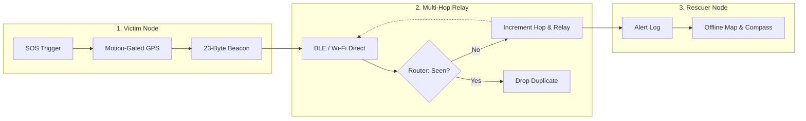

# DisasterSOS

Zero-infrastructure, peer-to-peer emergency mesh networking system for Android devices during disaster blackouts.

[-3DDC84.svg?logo=android&logoColor=white)](https://developer.android.com)
[](https://kotlinlang.org)
[](#architecture)
[-7EBC6F.svg?logo=openstreetmap&logoColor=white)](https://www.openstreetmap.org)

DisasterSOS is an ad-hoc emergency communication application built for scenarios where cellular networks and internet connectivity are unavailable (such as earthquakes, cyclones, and floods). The app turns nearby Android devices into multi-hop mesh relays to broadcast distress alerts, GPS coordinates, and battery status to rescuers.

---

## Features

- **Dual-Layer Hybrid Mesh Relay**: Uses Wi-Fi Direct for high-bandwidth local connections and Bluetooth Low Energy (BLE) advertisement flooding for zero-handshake broadcasts.
- **Offline Mapping (OSMDroid)**: Built with OpenStreetMap and local tile caching. Operates fully offline without Google Maps API keys or cloud billing.
- **Compass Guidance**: Computes magnetic azimuth vectors toward victim coordinates to guide rescuers without map data.
- **Power Optimization**:
  - **Tri-tier Duty Cycling**: Adjusts scan windows based on remaining battery (20s to 90s intervals) to extend uptime up to 48 hours.
  - **Motion-Gated GPS**: Suspends GPS polling when the phone is stationary to eliminate battery drain, resuming only on physical movement.
  - **Emergency Burst Mode**: Activates continuous transmission for 180 seconds when an SOS is manually triggered.
- **Loop and Storm Suppression**: Employs LRU message caching and hop-limit counters (maximum 15 hops) to prevent broadcast loops.

---

## Architecture



---

## Compact Beacon Protocol

To broadcast without requiring Bluetooth pairing, DisasterSOS encodes emergency telemetry into a 23-byte binary payload within BLE manufacturer data:

| Offset | Field | Type | Description |
|:---|:---|:---|:---|
| `[0]` | Magic Byte | `UInt8` | Identifier `0x53` (`'S'`) |
| `[1..6]` | Node ID | `ASCII[6]` | Device node identifier |
| `[7]` | Packet Type | `UInt8` | `1` = Victim SOS, `2` = Rescue Operation |
| `[8..11]` | Latitude | `Int32` | Scaled coordinate ($\text{lat} \times 10^6$) |
| `[12..15]` | Longitude | `Int32` | Scaled coordinate ($\text{lng} \times 10^6$) |
| `[16]` | Battery Level | `UInt8` | Battery percentage ($0 - 100\%$) |
| `[17]` | Hop Count | `UInt8` | Forwarding hop counter ($0 - 15$) |
| `[18..21]` | Timestamp | `UInt32` | Epoch seconds |
| `[22]` | Flags | `UInt8` | Bit 0: Critical battery flag |

---

## Project Structure

```text
app/src/main/
├── AndroidManifest.xml
└── java/com/innosence/disastersos/
    ├── MainActivity.kt               # Main dashboard activity
    ├── MapActivity.kt                # Offline OSMDroid tactical map
    ├── CompassActivity.kt            # Magnetometer navigation compass
    ├── data/
    │   ├── SOSPacket.kt              # Emergency packet data model
    │   ├── NodeInfo.kt               # Peer device representation
    │   └── PreferencesHelper.kt      # Role and state persistence
    ├── mesh/
    │   ├── BluetoothMeshManager.kt   # BLE advertising, scanning, and GATT routing
    │   ├── MeshManager.kt            # Wi-Fi Direct P2P discovery and sockets
    │   ├── MessageRouter.kt          # Duplicate suppression and hop limits
    │   └── CompactBeaconPayload.kt   # 23-byte binary encoder/decoder
    ├── power/
    │   ├── AdaptivePowerManager.kt   # Duty-cycle battery management
    │   └── MotionGatedLocationController.kt # Accelerometer-gated GPS controller
    ├── service/
    │   └── MeshService.kt            # Background mesh service
    └── ui/
        ├── AlertAdapter.kt           # Received SOS alert list adapter
        ├── DeviceAdapter.kt          # Connected peers list adapter
        └── RoleSelectionActivity.kt  # Role switcher (Victim / Rescuer)
```

---

## Privacy and Security

- **No Remote Servers**: Operates strictly peer-to-peer without external cloud infrastructure or backend servers.
- **No Third-Party Analytics**: Contains no telemetry trackers, advertising SDKs, or cloud crash reporters.
- **Randomized Node IDs**: Device identifiers are locally generated pseudorandom hashes; hardware identifiers (such as IMEI or MAC addresses) are never transmitted.

---

## Build and Installation

### Requirements
- Android Studio Ladybug (or newer)
- Android SDK 35 (compileSdk: 35, minSdk: 30)
- JDK 17
- Physical Android devices for hardware testing (Wi-Fi Direct and BLE mesh require real radios)

### Building from Source
```bash
# Clone the repository
git clone https://github.com/dhamodharan-13/Disaster-SOS.git
cd Disaster-SOS

# Build Debug APK
./gradlew assembleDebug
```
The compiled APK will be generated at `app/build/outputs/apk/debug/app-debug.apk`.

---

## Permissions

| Permission | Purpose |
|:---|:---|
| `ACCESS_FINE_LOCATION` | Attaches GPS coordinates to outgoing SOS alerts and enables Wi-Fi Direct discovery. |
| `BLUETOOTH_SCAN` & `BLUETOOTH_ADVERTISE` | Enables BLE advertisement broadcasting and peer discovery without pairing. |
| `NEARBY_WIFI_DEVICES` | Manages Wi-Fi Direct peer discovery and group formation. |
| `FOREGROUND_SERVICE_LOCATION` | Keeps mesh routing and alert reception active in the background. |
