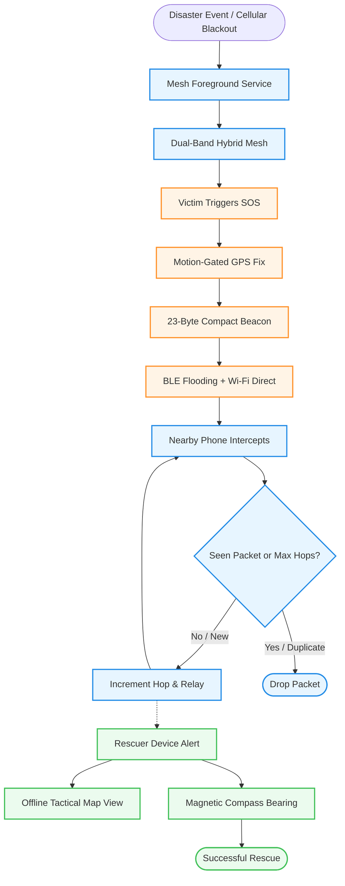

# DisasterSOS 🚨
### Zero-Infrastructure Offline Emergency Mesh Network for Disaster Blackouts

[-3DDC84.svg?logo=android&logoColor=white)](https://developer.android.com)
[](https://kotlinlang.org)
[](#mesh-architecture)
[-7EBC6F.svg?logo=openstreetmap&logoColor=white)](https://www.openstreetmap.org)
[](#privacy--security)

DisasterSOS is a decentralized, zero-infrastructure emergency mesh communication system designed for acute disaster scenarios (earthquakes, cyclones, floods, and grid collapses). When cellular towers and internet connections go down, DisasterSOS turns ordinary Android smartphones into resilient multi-hop relays that transmit distress signals, GPS coordinates, and battery telemetry across miles to find survivors.

---

## 🌟 Key Capabilities

* 📡 **Dual-Layer Hybrid Mesh Relay**: Combines high-speed Wi-Fi Direct (P2P) connections with zero-handshake 23-byte Bluetooth Low Energy (BLE) advertisement flooding.
* 🗺️ **100% Free & Offline Mapping**: Uses OpenStreetMap (`osmdroid`) with automatic local tile caching—**no Google Maps API keys or cloud billing accounts needed**.
* 🧭 **Tactical Compass Guidance**: Real-time magnetometer orientation vector that points directly toward victim coordinates with live distance estimation.
* 🔋 **Ultra-Low Battery Consumption**:
  * **Tri-Tier Adaptive Duty Cycling**: Dynamically dials radio scanning down from 20s to 90s based on battery level, extending device survival past 48+ hours.
  * **Accelerometer-Gated GPS**: Motion sensors sleep power-hungry GPS radios whenever a trapped survivor is stationary, awakening only on movement.
  * **Emergency Burst Mode**: 180-second continuous broadcast surge when an active SOS alert is triggered.
* 🛡️ **Intelligent Loop Suppression**: LRU signature caching and hop-limit counters (MAX_HOPS = 15) prevent broadcast storms and infinite message bouncing.

---

## 🏗️ Architecture & Network Flow



---

## 📦 Compact Binary Protocol (23-Byte BLE Beacon)

To enable zero-handshake dissemination across devices without requiring prior Bluetooth pairing, DisasterSOS serializes emergency packets into a custom 23-byte binary payload transmitted in BLE Manufacturer Data frames:

| Offset | Field | Type | Description |
|:---:|:---|:---:|:---|
| `[0]` | Magic Byte | `UInt8` | Identifier `0x53` (`'S'`) |
| `[1..6]` | Node ID | `ASCII[6]` | Unique 6-character node identifier |
| `[7]` | Packet Type | `UInt8` | `1` = Victim SOS, `2` = Rescue Operation |
| `[8..11]` | Latitude | `Int32` | Scaled coordinate ($\text{lat} \times 10^6$) |
| `[12..15]` | Longitude | `Int32` | Scaled coordinate ($\text{lng} \times 10^6$) |
| `[16]` | Battery Level | `UInt8` | State of charge ($0 - 100\%$) |
| `[17]` | Hop Count | `UInt8` | Bounces across mesh ($0 - 15$) |
| `[18..21]` | Timestamp | `UInt32` | Epoch seconds |
| `[22]` | Flags | `UInt8` | Bit 0: Critical Emergency Flag |

---

## 📂 Project Structure

```text
app/src/main/
├── AndroidManifest.xml
└── java/com/innosence/disastersos/
    ├── MainActivity.kt               # Central command dashboard
    ├── MapActivity.kt                # Offline OSMDroid tactical map & topology
    ├── CompassActivity.kt            # Magnetometer victim navigation compass
    ├── data/
    │   ├── SOSPacket.kt              # Core telemetry model
    │   ├── NodeInfo.kt               # Peer node descriptor
    │   └── PreferencesHelper.kt      # State & role persistence
    ├── mesh/
    │   ├── BluetoothMeshManager.kt   # Dual BLE scanner & GATT mesh coordinator
    │   ├── MeshManager.kt            # Wi-Fi Direct P2P discovery & socket router
    │   ├── MessageRouter.kt          # Deduping, hop limits & loop suppression
    │   └── CompactBeaconPayload.kt   # 23-byte zero-handshake binary serializer
    ├── power/
    │   ├── AdaptivePowerManager.kt   # Tri-tier duty-cycle battery survival engine
    │   └── MotionGatedLocationController.kt # Accelerometer-gated GPS power controller
    ├── service/
    │   └── MeshService.kt            # Persistent foreground service
    └── ui/
        ├── AlertAdapter.kt           # Recycler view for incoming SOS cards
        ├── DeviceAdapter.kt          # Live nearby device status adapter
        └── RoleSelectionActivity.kt  # Mode switcher (Victim / Rescuer)
```

---

## 🔒 Privacy & Security

* **Zero Cloud Dependence**: Operates completely air-gapped without remote servers, APIs, or user accounts.
* **No Telemetry Leakage**: No analytic trackers, crash reporting beacons, or proprietary identity keys.
* **Randomized Identifiers**: Device node IDs are randomly generated hashes with no personal device identifiers (IMEI, phone numbers, or hardware serials) broadcast.

---

## 🛠️ Build & Installation

### Requirements
* Android Studio Iguana / Ladybug or newer
* Android SDK 35 (compileSdk: 35, minSdk: 30)
* JDK 17
* Physical Android devices (Wi-Fi Direct and BLE mesh require real hardware radios)

### Building from Source
```bash
# Clone the repository
git clone https://github.com/dhamodharan-13/Disaster-SOS.git
cd Disaster-SOS

# Build Debug APK using Gradle
./gradlew assembleDebug
```
The compiled APK will be generated at `app/build/outputs/apk/debug/app-debug.apk`.

---

## 📜 Permissions Rationale

| Permission | Reason |
|:---|:---|
| `ACCESS_FINE_LOCATION` | Required to append GPS coordinates to emergency beacons and for Wi-Fi Direct peer discovery. |
| `BLUETOOTH_SCAN` & `BLUETOOTH_ADVERTISE` | Enables zero-handshake BLE advertisement flooding and GATT peer connectivity. |
| `NEARBY_WIFI_DEVICES` | Allows Wi-Fi Direct ad-hoc group formation without internet infrastructure. |
| `FOREGROUND_SERVICE_LOCATION` | Keeps the emergency mesh alive in the background during disaster conditions. |
